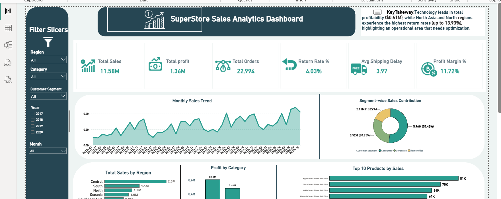

# Sales Analytics & Business Intelligence System

End-to-end analytics project using **Excel, SQL Server and Power BI** on SuperStore sales data
(46,990 order lines across 22,994 distinct orders, 2017-2020).

## Dashboard

## Project Overview
The goal was to turn raw commercial data into a reliable reporting system that shows
sales performance, profitability, returns and shipping operations.

## What I Did

**1. Excel: Data cleaning**
- Inspected the Orders, Persons and Returns files and documented data-quality issues in a cleaning log
- Standardised text-formatted numbers and dates, removed header rows and stray quotes

**2. SQL Server: Database and analysis**
- Designed tables: Orders (fact), Persons (lookup by Region), Returns (lookup by Order ID)
- Validated keys and relationships and handled 74 unmatched return records
- Wrote basic, intermediate and advanced analysis queries
- Built the reporting view `vw_Sales_Final` and validated its totals against the source table

**3. Power BI: Dashboard**
- Star-schema data model with a date table
- DAX measures: Total Sales, Total Profit, Total Orders, Average Order Value,
  Profit Margin %, Return Rate, Average Shipping Delay
- Interactive dashboard with slicers for Region, Category, Segment, Year and Month

**4. Scenario analysis**
- Discount change, shipping delay and return-rate scenarios with stated assumptions

## Key Findings
- Total sales: **11.58M**, total profit: **1.36M** (profit margin about 11.7%)
- **Central** is the top region by sales (2.57M)
- **Technology** is the top category by profit (0.61M)
- **662 products** are loss-making (combined loss about -227,868)
- **North Asia** has the highest return rate by region (13.93%)

## Tools
Excel | SQL Server | Power BI | DAX

## Repository Contents
| File | Description |
|---|---|
| `Sales_Cleaned_Data.xlsx` | Cleaned Orders, Persons and Returns sheets |
| `Cleaning_Log.xlsx` | Issues found, decisions made and validation results |
| `SalesAnalyst.sql` | Database structure, analysis queries and reporting view |
| `SQL_Evidence.xlsx` | Query inputs and outputs (basic, intermediate, advanced) |
| `Sales_Analyst3.pbix` | Power BI report |
| `dashboard.png`, `Screenshots.png` | Dashboard screenshots |
| `Final Report Structure.pdf` | Report outline |

## Notes and Assumptions
- Total Orders are counted as distinct Order IDs, because one order can have several line items
- Profit values stored as `Rs-` were treated as 0
- Emea had no person in the source table, so a placeholder row was added
- 74 of 1,000 return records have no matching order; return metrics use matched orders only
- Scenario results are estimates based on stated assumptions, not measured outcomes

## Author
Sheikh Azlan 
